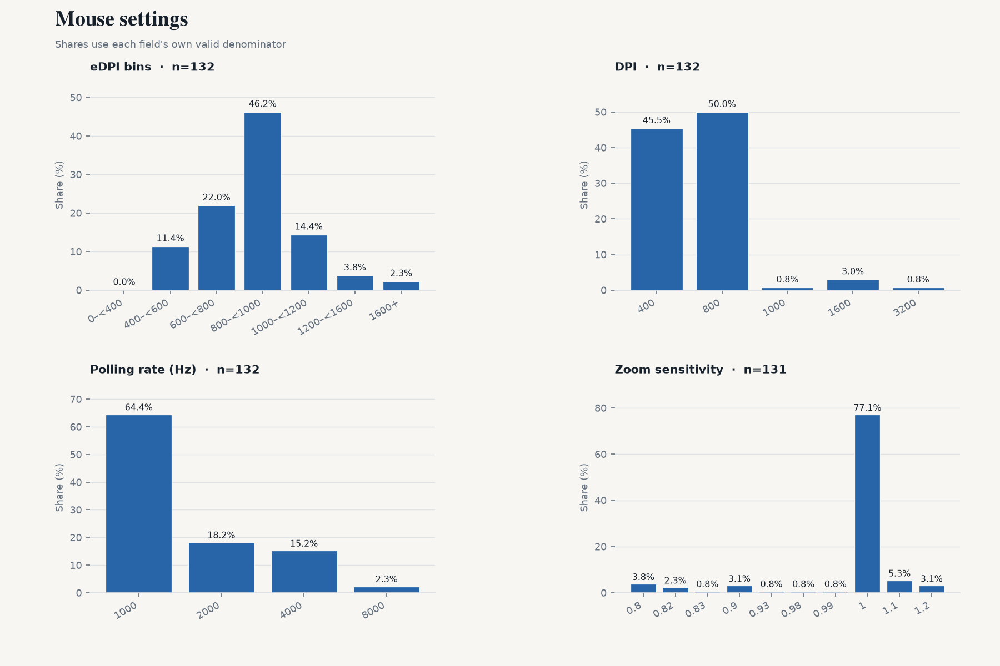
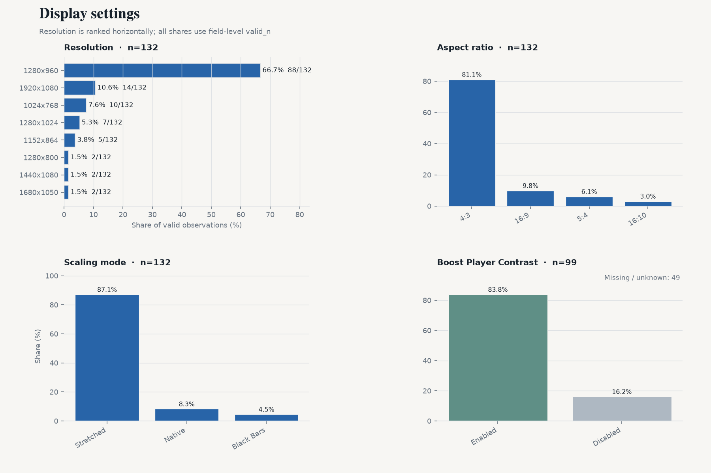
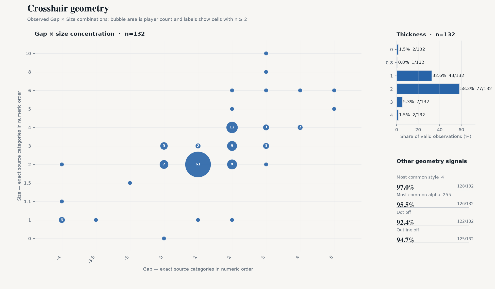
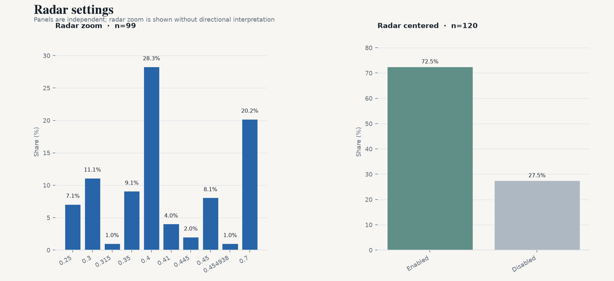

# CS2 Professional Settings Snapshot — 2026-10

[中文版](./2026-10.zh-CN.md)

2026-10-18 · VRS Top 30 (2026-08-10) · 30 teams · 148 players · 132/148 settings · `vrs-core-v2`

## 1. Highlights

- **800 median eDPI** (n=132)
- **4:3** at 81.1%; **1280x960** at 66.7% (n=132 / 132)
- **Stretched scaling** at 87.1% (n=132)
- **1000 Hz polling** at 64.4%; 4000 Hz+ at 17.4% (n=132)
- **Dot + outline both off** for 87.1% (n=132)

## 2. Mouse

- Median: **800** · Mean: **841.8** · n=132
- 600–1000 eDPI covers 68.2% of valid observations (90/132).
- Arithmetic QC: 130/132 consistent; **2 flagged** using max(2 eDPI, 1.0%) tolerance.
- DPI — 800: **50.0%** · 400: 45.5% · 1600+: 3.8% (n=132)
- Zoom sensitivity — median **1**; 1 77.1% · 1.1 5.3% · 0.8 3.8% (n=131)
- Polling — 1000: 64.4% · 2000: 18.2% · 4000: 15.2% · 8000 Hz: 2.3% (n=132)

## 3. Display

- Aspect ratio — 4:3 81.1% · 16:9 9.8% · 5:4 6.1% (n=132)
- Resolution — 1280x960 66.7% · 1920x1080 10.6% · 1024x768 7.6% (n=132)
- Scaling mode — Stretched 87.1% · Native 8.3% · Black Bars 4.5% (n=132)
- Boost Player Contrast — enabled **83.8%** (83/99 known); disabled 16/99; missing/unknown 49/148.

## 4. Crosshair

- Style codes — 4 97.0% · 5 1.5% · 3 0.8% (n=132); source-provided codes, with no mechanism interpretation.
- Size — median **2**; 2 59.8% · 3 14.4% · 4 12.9% (n=132)
- Gap — median **1**; 1 48.5% · 2 25.0% · 0 9.8% (n=132)
- Thickness — median **2**; 2 58.3% · 1 32.6% · 3 5.3% (n=132)
- Alpha — median **255**; 255 95.5% · 200 1.5% · 170 0.8% (n=132)
- Dot enabled — **7.6%** (10/132 known)
- Outline enabled — **5.3%** (7/132 known)
- Dot and outline both disabled: **87.1%** (n=132, both fields known)

- Color categories: Cyan 42.9% · Custom 28.6% · Yellow 28.6% (n=7)
- Custom RGB: **2/2** players with complete RGB (100.0%) · 2 unique exact colors · top **0,210,67** (50.0%)

## 5. Viewmodel

- `viewmodel_fov 68`: **90.4%** (n=125)
- Dominant offset: **X=2.5, Y=0, Z=-1.5**

## 6. Radar

- Radar zoom — median **0.4**; 0.4 28.3% · 0.7 20.2% · 0.3 11.1% (n=99). Values are descriptive; no directional interpretation is applied.
- Radar centered enabled: 72.5% (n=120)

## 7. Extended segments

| Segment | Teams | Players | Median eDPI |
|---|---:|---:|---:|
| VRS ∩ HLTV Consensus | 27 | 133 | 800 |
| Ranked Union | 31 | 153 | 800 |
| Core + Watchlist | 33 | 163 | 800 |
| All tracked | 34 | 168 | 800 |

## 8. Changes since previous snapshot

- Previous snapshot: 2026-08-11
- Core cohort: 149 → 148 players
- Roster turnover: 2.0%
- Matched players: 148

- crosshair_minimal_share: 0.8045 -> 0.8712 (+6.7pp) [level 1]
- crosshair_dominant_color: Custom -> Cyan (changed) [level 2]

Matched panel (same players in both snapshots):
- dpi: 0/132 changed
- edpi: 0/132 changed
- resolution: 0/132 changed
- polling_rate: 0/132 changed

## 9. Coverage & quality

| Field | valid_n / cohort |
|---|---|
| eDPI | 132 / 148 |
| DPI | 132 / 148 |
| Zoom sensitivity | 131 / 148 |
| Mouse polling rate | 132 / 148 |
| Resolution | 132 / 148 |
| Aspect ratio | 132 / 148 |
| Scaling mode | 132 / 148 |
| Boost Player Contrast | 99 / 148 |
| Crosshair color | 7 / 148 |
| Crosshair style | 132 / 148 |
| Crosshair size | 132 / 148 |
| Crosshair gap | 132 / 148 |
| Crosshair thickness | 132 / 148 |
| Crosshair alpha | 132 / 148 |
| Crosshair dot | 132 / 148 |
| Crosshair outline | 132 / 148 |
| Viewmodel FOV | 125 / 148 |
| Radar zoom | 99 / 148 |
| Radar centered | 120 / 148 |
| Radar rotating | 0 / 148 |
| Monitor refresh rate | 0 / 148 |
| fps_max | 0 / 148 |

132/148 Core players currently have at least one usable settings field.
eDPI arithmetic QC flags 2/132 comparable observations; flags remain quality signals and do not overwrite source values.

## 10. Data & code

- Snapshot date: 2026-10-18
- Source: cs2settings
- Snapshot data: [`data/aggregate/2026-10.json`](../data/aggregate/2026-10.json)
- Project & methodology: [`README.md`](../README.md)
