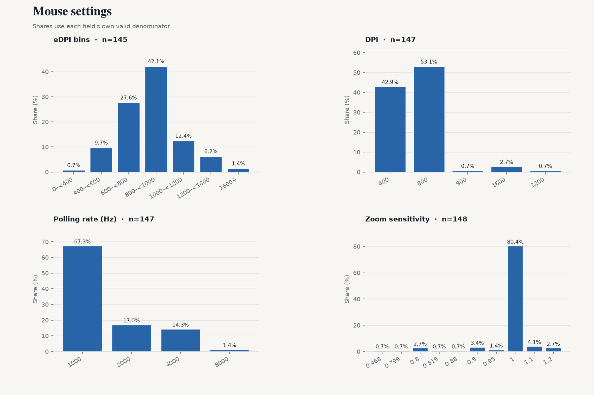
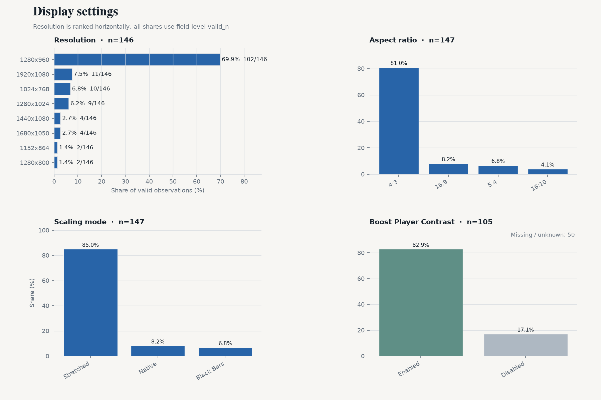
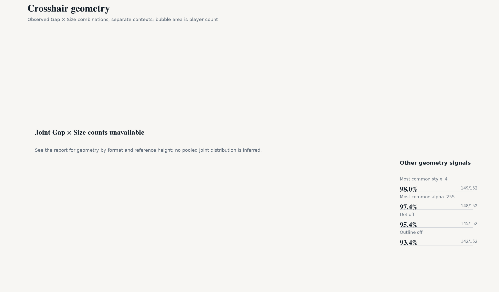
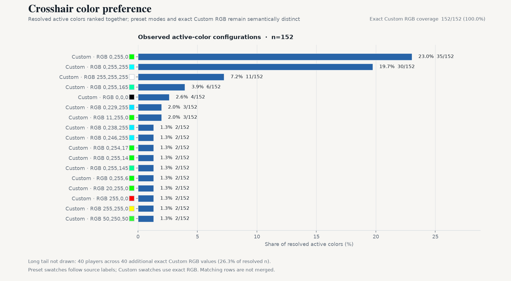
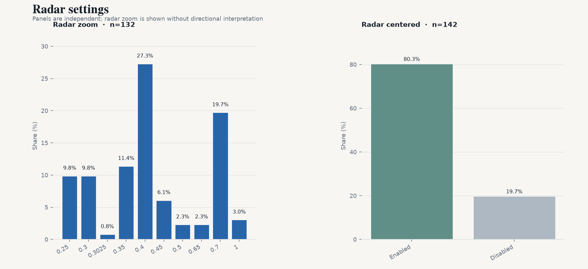

# CS2 Professional Settings Snapshot — 2026-11

[中文版](./2026-11.zh-CN.md)

2026-11-28 · VRS Top 30 (2026-11-02) · 30 teams · 155 players · 152/155 settings · `vrs-core-v2`

## 1. Highlights

- **800 median eDPI** (n=145)
- **4:3** at 81.0%; **1280x960** at 69.9% (n=147 / 146)
- **Stretched scaling** at 85.0% (n=147)
- **1000 Hz polling** at 67.3%; 4000 Hz+ at 15.6% (n=147)
- **Dot + outline both off** for 90.1% (n=152)

## 2. Mouse

- Median: **800** · Mean: **837.2** · n=145
- 600–1000 eDPI covers 69.7% of valid observations (101/145).
- Arithmetic QC: 144/145 consistent; **1 flagged** using max(2 eDPI, 1.0%) tolerance.
- DPI — 800: **53.1%** · 400: 42.9% · 1600+: 3.4% (n=147)
- Zoom sensitivity — median **1**; 1 80.4% · 1.1 4.1% · 0.9 3.4% (n=148)
- Polling — 1000: 67.3% · 2000: 17.0% · 4000: 14.3% · 8000 Hz: 1.4% (n=147)

## 3. Display

- Aspect ratio — 4:3 81.0% · 16:9 8.2% · 5:4 6.8% (n=147)
- Resolution — 1280x960 69.9% · 1920x1080 7.5% · 1024x768 6.8% (n=146)
- Scaling mode — Stretched 85.0% · Native 8.2% · Black Bars 6.8% (n=147)
- Boost Player Contrast — enabled **82.9%** (87/105 known); disabled 18/105; missing/unknown 50/155.

## 4. Crosshair

Pixel geometry is grouped by format and reference screen height; Custom includes direct RGB. Initialize a new crosshair baseline. Custom includes direct RGB, not an inferred legacy mode selection.

| Format / units / reference height | Size median (n) | Gap median (n) | Thickness median (n) |
|---|---:|---:|---:|
| cs2-v1:px@1024 | 2 (8) | 1 (8) | 2 (8) |
| cs2-v1:px@1050 | 2 (1) | 1 (1) | 2 (1) |
| cs2-v1:px@1080 | 2 (21) | 1 (21) | 2 (21) |
| cs2-v1:px@768 | 2.5 (6) | 1.5 (6) | 1 (6) |
| cs2-v1:px@800 | 3 (1) | 2 (1) | 1 (1) |
| cs2-v1:px@864 | 2 (4) | 1 (4) | 2 (4) |
| cs2-v1:px@900 | 2 (1) | 1 (1) | 2 (1) |
| cs2-v1:px@960 | 2 (109) | 1 (109) | 2 (109) |
| cs2-v1:px@990 | 2 (1) | 1 (1) | 2 (1) |

Outline (none / full / half): 142 / 7 / 3 (n=152)

- Style codes — 4 98.0% · 5 2.0% (n=152); source-provided codes, with no mechanism interpretation.
- Alpha — median **255**; 255 97.4% · 200 1.3% · 159 0.7% (n=152)
- Dot enabled — **4.6%** (7/152 known)
- Outline enabled — **6.6%** (10/152 known)
- Dot and outline both disabled: **90.1%** (n=152, both fields known)

- Color categories: Custom 100.0% (n=152)
- Custom RGB: **152/152** players with complete RGB (100.0%) · 57 unique exact colors · top **0,255,0** (23.0%)

## 5. Viewmodel

- `viewmodel_fov 68`: **86.7%** (n=150)
- Dominant offset: **X=2.5, Y=0, Z=-1.5**

## 6. Radar

- Radar zoom — median **0.4**; 0.4 27.3% · 0.7 19.7% · 0.35 11.4% (n=132). Values are descriptive; no directional interpretation is applied.
- Radar centered enabled: 80.3% (n=142)

## 7. Extended segments

| Segment | Teams | Players | Median eDPI |
|---|---:|---:|---:|
| VRS ∩ HLTV Consensus | 22 | 115 | 800 |
| Ranked Union | 37 | 194 | 800 |
| Core + Watchlist | 31 | 160 | 800 |
| All tracked | 38 | 199 | 800 |

## 8. Changes since previous snapshot

- Previous snapshot: 2026-08-11
- Core cohort: 149 → 155 players
- Roster turnover: 9.2%
- Matched players: 110

- radar_centered_share: 0.7167 -> 0.8028 (+8.6pp) [level 1]

Matched panel (same players in both snapshots):
- dpi: 5/101 changed, 4 missing->value
- edpi: 32/101 changed, 4 missing->value
- resolution: 16/101 changed, 4 missing->value
- polling_rate: 6/101 changed, 4 missing->value

## 9. Coverage & quality

| Field | valid_n / cohort |
|---|---|
| eDPI | 145 / 155 |
| DPI | 147 / 155 |
| Zoom sensitivity | 148 / 155 |
| Mouse polling rate | 147 / 155 |
| Resolution | 146 / 155 |
| Aspect ratio | 147 / 155 |
| Scaling mode | 147 / 155 |
| Boost Player Contrast | 105 / 155 |
| Crosshair color | 152 / 155 |
| Crosshair style | 152 / 155 |
| Crosshair size | 0 / 155 |
| Crosshair gap | 0 / 155 |
| Crosshair thickness | 0 / 155 |
| Crosshair alpha | 152 / 155 |
| Crosshair dot | 152 / 155 |
| Crosshair outline | 152 / 155 |
| Viewmodel FOV | 150 / 155 |
| Radar zoom | 132 / 155 |
| Radar centered | 142 / 155 |
| Radar rotating | 0 / 155 |
| Monitor refresh rate | 0 / 155 |
| fps_max | 0 / 155 |

152/155 Core players currently have at least one usable settings field.
eDPI arithmetic QC flags 1/145 comparable observations; flags remain quality signals and do not overwrite source values.

## 10. Data & code

- Snapshot date: 2026-11-28
- Source: cs2settings
- Snapshot data: [`data/aggregate/2026-11.json`](../data/aggregate/2026-11.json)
- Project & methodology: [`README.md`](../README.md)
