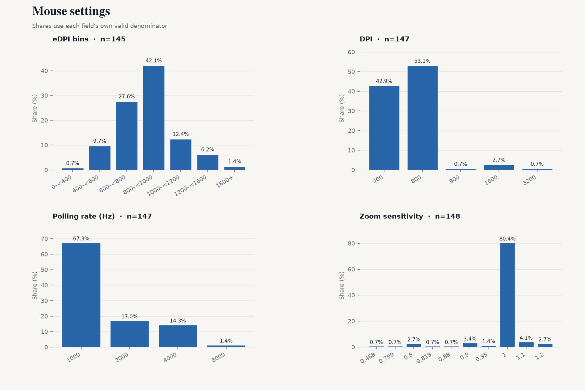
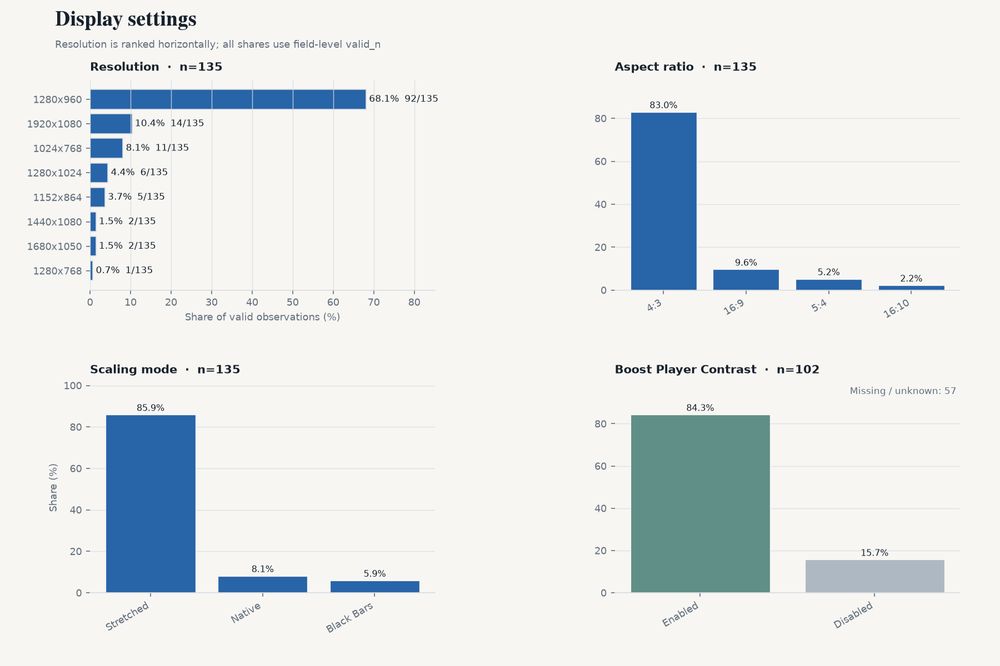
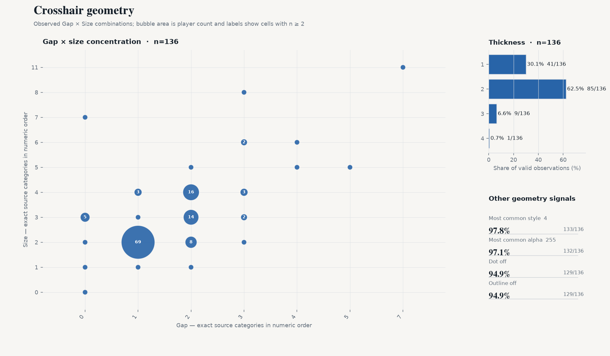
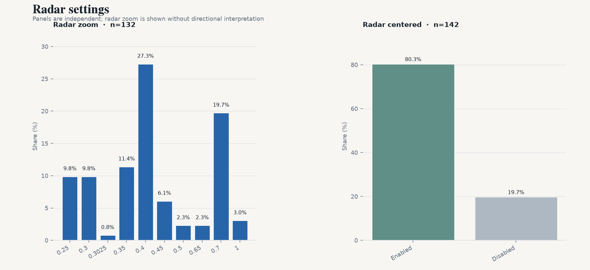

# CS2 职业选手设置月度快照 — 2026-11

[English version](./2026-11.md)

2026-11-15 · VRS Top 30（2026-08-10）· 30 支战队 · 159 名选手 · 设置覆盖 135/159 · `vrs-core-v2`

## 1. 本期要点

- **eDPI 中位数 800**（n=135）
- **4:3** 占 83.0%；**1280x960** 占 68.1%（n=135 / 135）
- **Stretched 缩放**占 85.9%（n=135）
- **1000 Hz 回报率**占 66.7%；4000 Hz+ 占 14.8%（n=135）
- **Dot 与 outline 同时关闭**占 88.1%（n=135）

## 2. 鼠标

- 中位数：**800** · 平均值：**846.9** · 有效样本：135
- 600–1000 eDPI 覆盖 68.1% 的有效样本（92/135）。
- 算术 QC：133/135 一致；按 max(2 eDPI, 1.0%) 容差标记 **2 项**。
- DPI — 800：**50.4%** · 400：44.4% · 1600+：4.4%（n=135）
- 开镜灵敏度 — 中位数 **1**；1 76.9% · 1.1 5.2% · 0.8 3.7%（n=134）
- 回报率 — 1000：66.7% · 2000：18.5% · 4000：12.6% · 8000 Hz：2.2%（n=135）

## 3. 显示

- 宽高比 — 4:3 83.0% · 16:9 9.6% · 5:4 5.2%（n=135）
- 分辨率 — 1280x960 68.1% · 1920x1080 10.4% · 1024x768 8.1%（n=135）
- 缩放模式 — Stretched 85.9% · Native 8.1% · Black Bars 5.9%（n=135）
- Boost Player Contrast — 已开启 **84.3%** （86/102 项已知）；关闭 16/102；缺失/未知 57/159。

## 4. 准星

- Style 原始代码 — 4 97.0% · 5 0.7% · 6 0.7%（n=135）；仅按来源值报告，不解释机制。
- Size — 中位数 **2**；2 58.5% · 3 17.0% · 4 14.1%（n=135）
- Gap — 中位数 **1**；1 52.6% · 2 30.4% · 0 7.4%（n=135）
- Thickness — 中位数 **2**；2 65.2% · 1 28.1% · 3 5.9%（n=135）
- Alpha — 中位数 **255**；255 97.0% · 159 0.7% · 200 0.7%（n=135）
- Dot 开启 — **5.9%**（8/135 项已知）
- Outline 开启 — **6.7%**（9/135 项已知）
- Dot 与 outline 同时关闭：**88.1%**（n=135，两字段均已知）

## 5. Viewmodel

- `viewmodel_fov 68`：**89.9%**（n=129）
- 最常见三轴偏移：**X=2.5, Y=0, Z=-1.5**

## 6. Radar

- Radar zoom — 中位数 **0.4**；0.4 28.2% · 0.7 20.4% · 0.3 10.7%（n=103）。仅报告数值分布，不作方向性解释。
- Radar centered 开启：73.4%（n=124）

## 7. 扩展样本

| Segment | 战队 | 选手 | eDPI 中位数 |
|---|---:|---:|---:|
| VRS ∩ HLTV Consensus | 27 | 144 | 800 |
| Ranked Union | 31 | 164 | 800 |
| Core + Watchlist | 33 | 174 | 800 |
| All tracked | 34 | 179 | 800 |

## 8. 相比上期

- 上一期：2026-08-11
- Core cohort：149 → 159 名选手
- roster turnover：0.0%
- matched players：159

- crosshair_minimal_share: 0.8045 -> 0.8815 (+7.7pp) [level 1]

同选手 matched panel（两期均在样本中的选手）：
- dpi: 0/135 changed
- edpi: 0/135 changed
- resolution: 0/135 changed
- polling_rate: 0/135 changed

## 9. 覆盖与质量

| 字段 | valid_n / cohort |
|---|---|
| eDPI | 135 / 159 |
| DPI | 135 / 159 |
| 开镜灵敏度 | 134 / 159 |
| 鼠标回报率 | 135 / 159 |
| 分辨率 | 135 / 159 |
| 宽高比 | 135 / 159 |
| 缩放模式 | 135 / 159 |
| Boost Player Contrast | 102 / 159 |
| 准星颜色 | 0 / 159 |
| 准星 style | 135 / 159 |
| 准星 size | 135 / 159 |
| 准星 gap | 135 / 159 |
| 准星 thickness | 135 / 159 |
| 准星 alpha | 135 / 159 |
| 准星 dot | 135 / 159 |
| 准星 outline | 135 / 159 |
| Viewmodel FOV | 129 / 159 |
| Radar zoom | 103 / 159 |
| Radar centered | 124 / 159 |
| Radar rotating | 0 / 159 |
| 显示器刷新率 | 0 / 159 |
| fps_max | 0 / 159 |

当前 135/159 名 Core 选手至少有一项可用设置字段。
eDPI 算术 QC 在 135 项可比较记录中标记 2 项；标记仅作为质量信号，不覆盖来源值。

## 10. 数据与代码

- 数据日期：2026-11-15
- 数据来源：cs2settings
- 快照数据：[`data/aggregate/2026-11.json`](../data/aggregate/2026-11.json)
- 项目与方法：[`README.md`](../README.md)
