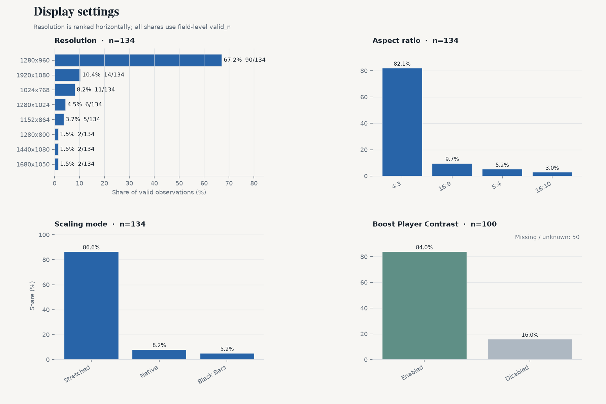
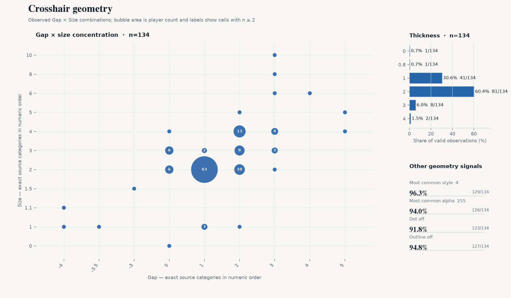
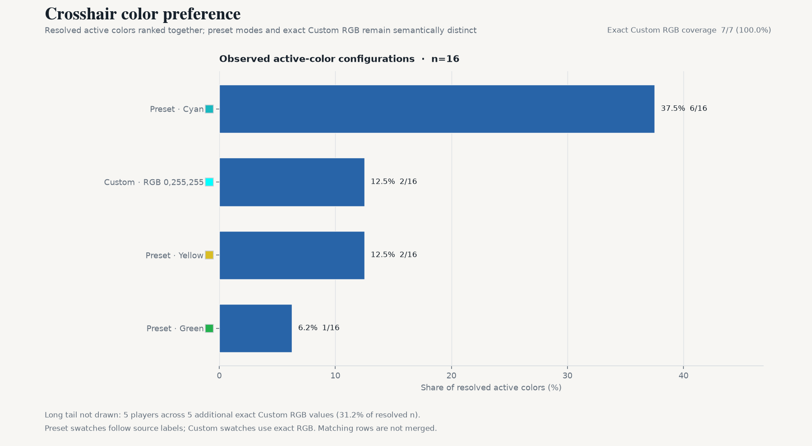

# CS2 Professional Settings Snapshot — 2026-10

[中文版](./latest.zh-CN.md)

2026-10-22 · VRS Top 30 (2026-08-10) · 30 teams · 150 players · 134/150 settings · `vrs-core-v2`

## 1. Highlights

- **800 median eDPI** (n=134)
- **4:3** at 82.1%; **1280x960** at 67.2% (n=134 / 134)
- **Stretched scaling** at 86.6% (n=134)
- **1000 Hz polling** at 65.7%; 4000 Hz+ at 16.4% (n=134)
- **Dot + outline both off** for 85.8% (n=134)

## 2. Mouse

- Median: **800** · Mean: **846.5** · n=134
- 600–1000 eDPI covers 67.9% of valid observations (91/134).
- Arithmetic QC: 132/134 consistent; **2 flagged** using max(2 eDPI, 1.0%) tolerance.
- DPI — 800: **49.3%** · 400: 45.5% · 1600+: 4.5% (n=134)
- Zoom sensitivity — median **1**; 1 76.7% · 1.1 5.3% · 0.8 3.8% (n=133)
- Polling — 1000: 65.7% · 2000: 17.9% · 4000: 14.2% · 8000 Hz: 2.2% (n=134)

## 3. Display

- Aspect ratio — 4:3 82.1% · 16:9 9.7% · 5:4 5.2% (n=134)
- Resolution — 1280x960 67.2% · 1920x1080 10.4% · 1024x768 8.2% (n=134)
- Scaling mode — Stretched 86.6% · Native 8.2% · Black Bars 5.2% (n=134)
- Boost Player Contrast — enabled **84.0%** (84/100 known); disabled 16/100; missing/unknown 50/150.

## 4. Crosshair

- Style codes — 4 94.8% · 5 1.5% · 8 1.5% (n=134); source-provided codes, with no mechanism interpretation.
- Size — median **2**; 2 61.2% · 3 14.2% · 4 12.7% (n=134)
- Gap — median **1**; 1 51.5% · 2 23.9% · 0 11.2% (n=134)
- Thickness — median **2**; 2 61.2% · 1 29.9% · 3 6.0% (n=134)
- Alpha — median **255**; 255 94.8% · 200 1.5% · 170 0.7% (n=134)
- Dot enabled — **8.2%** (11/134 known)
- Outline enabled — **6.7%** (9/134 known)
- Dot and outline both disabled: **85.8%** (n=134, both fields known)

- Color categories: Cyan 50.0% · Yellow 50.0% (n=4)

## 5. Viewmodel

- `viewmodel_fov 68`: **90.6%** (n=128)
- Dominant offset: **X=2.5, Y=0, Z=-1.5**

## 6. Radar

- Radar zoom — median **0.4**; 0.4 28.0% · 0.7 20.0% · 0.3 11.0% (n=100). Values are descriptive; no directional interpretation is applied.
- Radar centered enabled: 72.1% (n=122)

## 7. Extended segments

| Segment | Teams | Players | Median eDPI |
|---|---:|---:|---:|
| VRS ∩ HLTV Consensus | 27 | 135 | 800 |
| Ranked Union | 31 | 155 | 800 |
| Core + Watchlist | 33 | 165 | 800 |
| All tracked | 34 | 170 | 800 |

## 8. Changes since previous snapshot

- Previous snapshot: 2026-08-11
- Core cohort: 149 → 150 players
- Roster turnover: 0.7%
- Matched players: 150

- crosshair_minimal_share: 0.8045 -> 0.8582 (+5.4pp) [level 1]
- crosshair_dominant_color: Custom -> Cyan (changed) [level 2]

Matched panel (same players in both snapshots):
- dpi: 0/134 changed
- edpi: 0/134 changed
- resolution: 0/134 changed
- polling_rate: 0/134 changed

## 9. Coverage & quality

| Field | valid_n / cohort |
|---|---|
| eDPI | 134 / 150 |
| DPI | 134 / 150 |
| Zoom sensitivity | 133 / 150 |
| Mouse polling rate | 134 / 150 |
| Resolution | 134 / 150 |
| Aspect ratio | 134 / 150 |
| Scaling mode | 134 / 150 |
| Boost Player Contrast | 100 / 150 |
| Crosshair color | 4 / 150 |
| Crosshair style | 134 / 150 |
| Crosshair size | 134 / 150 |
| Crosshair gap | 134 / 150 |
| Crosshair thickness | 134 / 150 |
| Crosshair alpha | 134 / 150 |
| Crosshair dot | 134 / 150 |
| Crosshair outline | 134 / 150 |
| Viewmodel FOV | 128 / 150 |
| Radar zoom | 100 / 150 |
| Radar centered | 122 / 150 |
| Radar rotating | 0 / 150 |
| Monitor refresh rate | 0 / 150 |
| fps_max | 0 / 150 |

134/150 Core players currently have at least one usable settings field.
eDPI arithmetic QC flags 2/134 comparable observations; flags remain quality signals and do not overwrite source values.

## 10. Data & code

- Snapshot date: 2026-10-22
- Source: cs2settings
- Snapshot data: [`data/aggregate/2026-10.json`](../data/aggregate/2026-10.json)
- Project & methodology: [`README.md`](../README.md)
