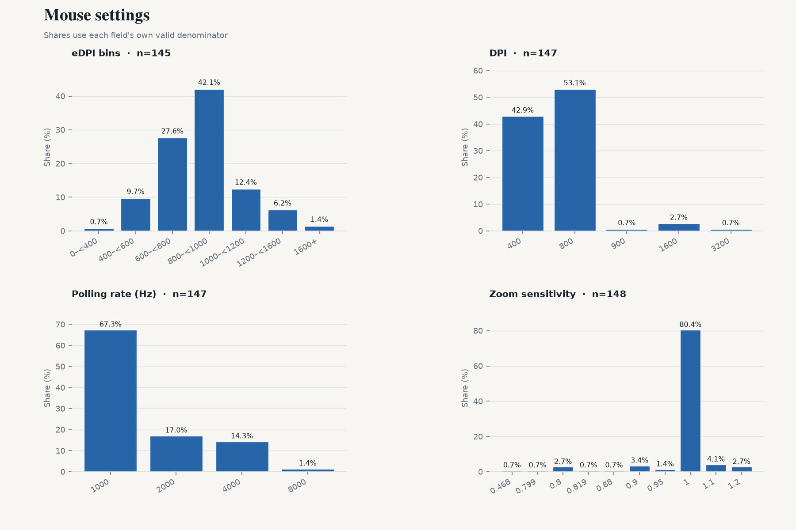
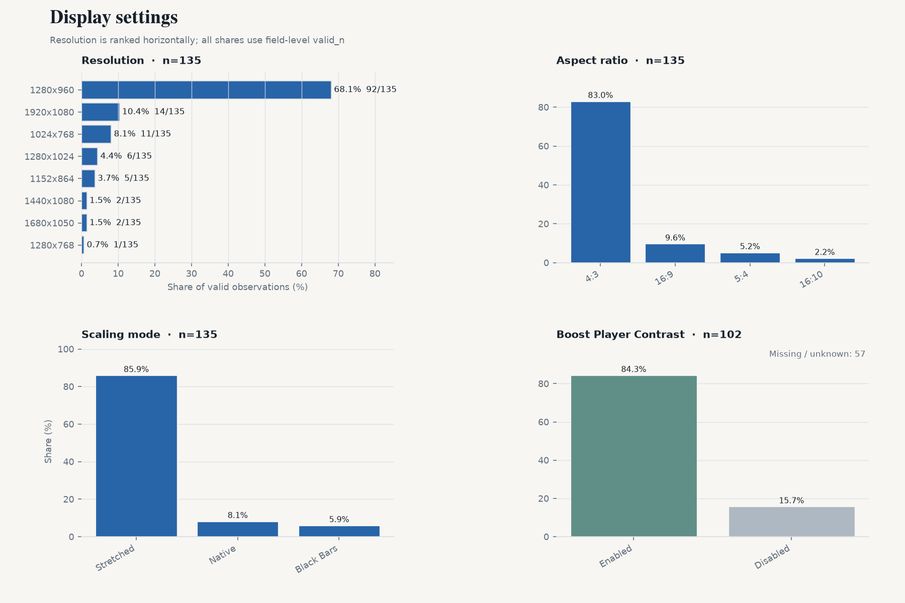
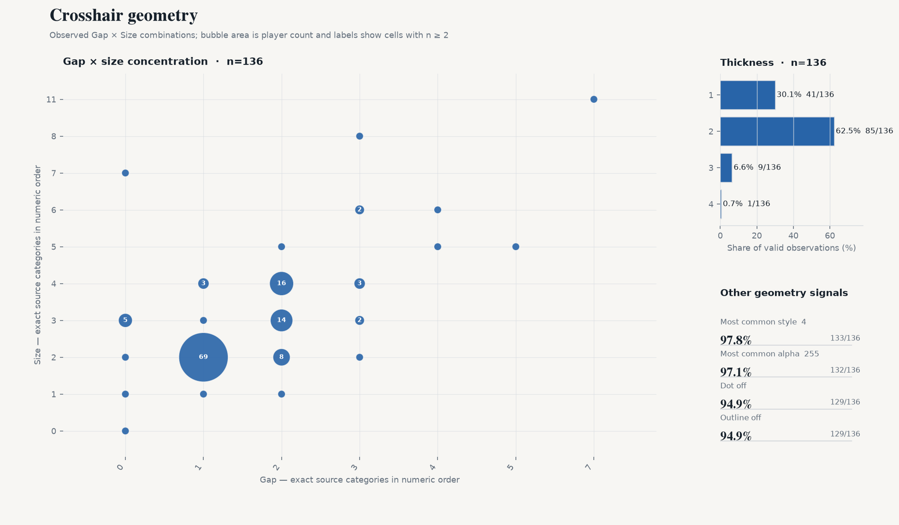
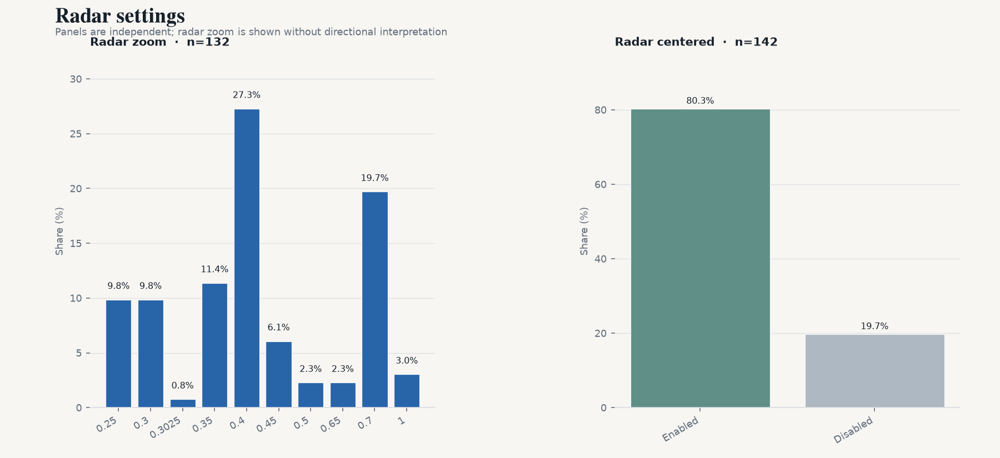

# CS2 职业选手设置月度快照 — 2026-11

[English version](./latest.md)

2026-11-08 · VRS Top 30（2026-08-10）· 30 支战队 · 158 名选手 · 设置覆盖 136/158 · `vrs-core-v2`

## 1. 本期要点

- **eDPI 中位数 800**（n=136）
- **4:3** 占 82.4%；**1280x960** 占 67.6%（n=136 / 136）
- **Stretched 缩放**占 85.3%（n=136）
- **1000 Hz 回报率**占 66.2%；4000 Hz+ 占 15.4%（n=136）
- **Dot 与 outline 同时关闭**占 90.4%（n=136）

## 2. 鼠标

- 中位数：**800** · 平均值：**845.8** · 有效样本：136
- 600–1000 eDPI 覆盖 68.4% 的有效样本（93/136）。
- 算术 QC：134/136 一致；按 max(2 eDPI, 1.0%) 容差标记 **2 项**。
- DPI — 800：**50.0%** · 400：44.9% · 1600+：4.4%（n=136）
- 开镜灵敏度 — 中位数 **1**；1 77.0% · 1.1 5.2% · 0.8 3.7%（n=135）
- 回报率 — 1000：66.2% · 2000：18.4% · 4000：13.2% · 8000 Hz：2.2%（n=136）

## 3. 显示

- 宽高比 — 4:3 82.4% · 16:9 10.3% · 5:4 5.1%（n=136）
- 分辨率 — 1280x960 67.6% · 1920x1080 11.0% · 1024x768 8.1%（n=136）
- 缩放模式 — Stretched 85.3% · Native 8.8% · Black Bars 5.9%（n=136）
- Boost Player Contrast — 已开启 **84.3%** （86/102 项已知）；关闭 16/102；缺失/未知 56/158。

## 4. 准星

- Style 原始代码 — 4 97.8% · 5 0.7% · 8 0.7%（n=136）；仅按来源值报告，不解释机制。
- Size — 中位数 **2**；2 58.1% · 3 16.2% · 4 16.2%（n=136）
- Gap — 中位数 **1**；1 54.4% · 2 29.4% · 0 6.6%（n=136）
- Thickness — 中位数 **2**；2 62.5% · 1 30.1% · 3 6.6%（n=136）
- Alpha — 中位数 **255**；255 97.1% · 197 0.7% · 200 0.7%（n=136）
- Dot 开启 — **5.1%**（7/136 项已知）
- Outline 开启 — **5.1%**（7/136 项已知）
- Dot 与 outline 同时关闭：**90.4%**（n=136，两字段均已知）

## 5. Viewmodel

- `viewmodel_fov 68`：**90.0%**（n=130）
- 最常见三轴偏移：**X=2.5, Y=0, Z=-1.5**

## 6. Radar

- Radar zoom — 中位数 **0.4**；0.4 28.2% · 0.7 20.4% · 0.3 10.7%（n=103）。仅报告数值分布，不作方向性解释。
- Radar centered 开启：73.4%（n=124）

## 7. 扩展样本

| Segment | 战队 | 选手 | eDPI 中位数 |
|---|---:|---:|---:|
| VRS ∩ HLTV Consensus | 27 | 143 | 800 |
| Ranked Union | 31 | 163 | 800 |
| Core + Watchlist | 33 | 173 | 800 |
| All tracked | 34 | 178 | 800 |

## 8. 相比上期

- 上一期：2026-08-11
- Core cohort：149 → 158 名选手
- roster turnover：0.0%
- matched players：158

- crosshair_minimal_share: 0.8045 -> 0.9044 (+10.0pp) [level 1]

同选手 matched panel（两期均在样本中的选手）：
- dpi: 0/136 changed
- edpi: 0/136 changed
- resolution: 0/136 changed
- polling_rate: 0/136 changed

## 9. 覆盖与质量

| 字段 | valid_n / cohort |
|---|---|
| eDPI | 136 / 158 |
| DPI | 136 / 158 |
| 开镜灵敏度 | 135 / 158 |
| 鼠标回报率 | 136 / 158 |
| 分辨率 | 136 / 158 |
| 宽高比 | 136 / 158 |
| 缩放模式 | 136 / 158 |
| Boost Player Contrast | 102 / 158 |
| 准星颜色 | 0 / 158 |
| 准星 style | 136 / 158 |
| 准星 size | 136 / 158 |
| 准星 gap | 136 / 158 |
| 准星 thickness | 136 / 158 |
| 准星 alpha | 136 / 158 |
| 准星 dot | 136 / 158 |
| 准星 outline | 136 / 158 |
| Viewmodel FOV | 130 / 158 |
| Radar zoom | 103 / 158 |
| Radar centered | 124 / 158 |
| Radar rotating | 0 / 158 |
| 显示器刷新率 | 0 / 158 |
| fps_max | 0 / 158 |

当前 136/158 名 Core 选手至少有一项可用设置字段。
eDPI 算术 QC 在 136 项可比较记录中标记 2 项；标记仅作为质量信号，不覆盖来源值。

## 10. 数据与代码

- 数据日期：2026-11-08
- 数据来源：cs2settings
- 快照数据：[`data/aggregate/2026-11.json`](../data/aggregate/2026-11.json)
- 项目与方法：[`README.md`](../README.md)
